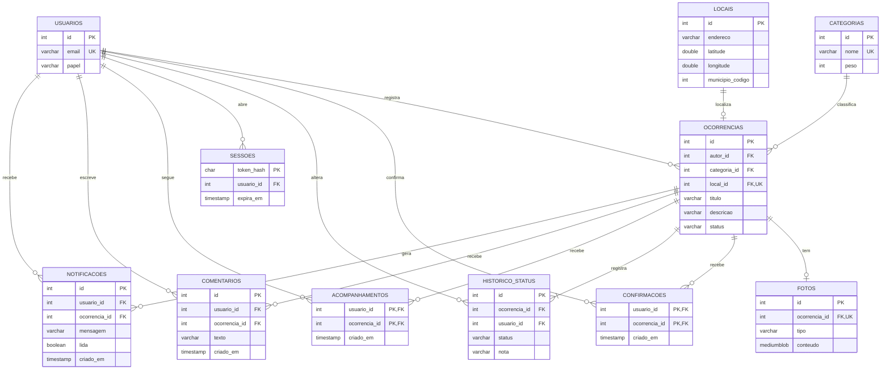

# Modelo de dados do Cidade Viva

O esquema para novas instalações implementa dez entidades de negócio e uma tabela de apoio à autenticação. Os atributos e as restrições estão em [db/schema.sql](../db/schema.sql) e [db/upgrade.sql](../db/upgrade.sql).

Instalações anteriores mantêm a tabela `locais_verificados` até a migração administrativa. A migração copia e verifica os códigos antes de remover a tabela. Com o servidor parado, execute `node db/migrate-locations.mjs` a partir da raiz do projeto. Forneça as credenciais administrativas temporárias pelas variáveis `DB_MIGRATION_USER` e `DB_MIGRATION_PASSWORD`.

- Todo relato tem um autor, uma categoria, um local e um primeiro registro de histórico. Cadastro do relato e primeiro histórico acontecem na mesma transação.
- O local exige endereço, coordenadas completas ou ambos. Uma ocorrência pode incluir uma foto.
- A chave composta de confirmações limita cada cidadão a uma confirmação por ocorrência. A API bloqueia a confirmação pelo autor ou em relato resolvido.
- A prioridade é calculada na visão SQL: **2 × peso da categoria + 2 × confirmações + até 6 pontos pela idade**, somando um ponto por dia completo. A ordenação por prioridade exibe ocorrências resolvidas depois das demais.
- As sessões expiram em sete dias. O banco armazena o hash da senha com scrypt e o hash do token de sessão.

- O local é verificado pelo polígono do IBGE. O código 3550308 é armazenado em `locais.municipio_codigo` quando o ponto está dentro de São Paulo. O código zero identifica locais antigos sem ponto válido no município.
- Acompanhamentos usam a chave composta de usuário e ocorrência. Mudanças de status geram um aviso ao autor e aos seguidores, com a mesma transação do histórico.
- Comentários guardam autor e ocorrência. O autor do comentário ou a administração pode excluí-lo.
